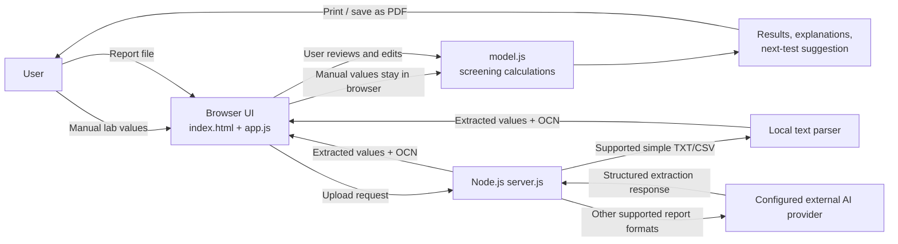

# LabLens presentation handoff

**Purpose:** source material for a detailed final-project presentation and for an AI slide-generation tool.  
**Project type:** AI/ML in healthcare honors mini project; browser-based laboratory report review and screening prototype.  
**Suggested presentation title:** *LabLens: A Browser-Based Tool for Reviewing Incomplete Laboratory Reports*

## Read this before making slides: evidence and prototype status

The current repository is a working web prototype, but its `model.js` identifies itself as `placeholder` and sets `placeholder: true`. Its weights are hand-entered placeholders. Therefore, the risk percentages currently displayed by the website are demonstration outputs. They are **not** results from the described NHANES-trained models, and they must not be presented as clinically validated predictions or as evaluation results.

The project description supplied by the author describes an intended training and evaluation pipeline (five logistic regression models, NHANES 2017–2018, random masking, a mean-imputation baseline, AUROC and calibration evaluation). The checked-in project does not include the training notebook, exported trained coefficients, cohort-generation code, or model evaluation results. Treat those details as the stated design/methodology until the author supplies the notebook or results. Do not invent sample sizes, AUROCs, calibration scores, confidence intervals, or claims of clinical validation. A strong presentation can transparently explain the intended method and identify trained-model evaluation as future work.

The repository also contains API tests for the report-reading server. Those are software behavior tests, not evidence that the screening model is accurate or clinically safe.

## 1. Introduction

People often receive blood-test reports containing unfamiliar abbreviations, units, and reference ranges. They may have only some tests because tests are ordered at different times or are not affordable or available together. LabLens is designed to help a person enter the results they have, review extracted values, and understand which results may merit follow-up.

LabLens has two input paths:

1. **Manual entry:** enter demographic context and any available lab values; leave unavailable fields blank.
2. **Report reading:** upload a report file. The server reads supported simple text/CSV locally; other supported report types can be sent to the configured external AI provider for extraction. Extracted values should be checked against the original report before use.

The screening page presents five condition areas: anemia, prediabetes/diabetes, reduced kidney function, liver stress, and high LDL cholesterol. It is intended as an educational screening aid, not a diagnosis or replacement for a clinician.

## 2. Problem statement

**Problem:** A person may have a partial laboratory report and limited ability to interpret its measurements. Conventional interpretation assumes that the relevant test is present, while many machine-learning prediction approaches are developed on complete or imputed records. This can make them less useful when real-world reports are incomplete. Report images and PDFs also require values to be transcribed before analysis, creating another source of effort and error.

**Project question:** Can a simple web tool accept whichever supported values a person has, help extract and verify values from a report, and provide understandable preliminary screening information without requiring every test?

**Boundaries:** LabLens screens a small set of conditions from selected common laboratory values. It is not a diagnostic system, does not establish disease, and has not been demonstrated to generalize to Indian patients. The current model weights are placeholders.

## 3. Scope and objectives

### Objectives described for the project

- Provide a simple manual form that permits missing values.
- Let users upload a report and review/edit extracted measurements.
- Estimate risk for five specified condition groups using models intended to tolerate missing inputs.
- If a defining test is present, show a cutoff-based measured status for that condition instead of a model estimate.
- Explain the leading factors associated with a model estimate in plain language and suggest one potentially useful next test.
- Highlight selected dangerously abnormal results, support English and Hindi, and allow printing/saving as PDF.
- Keep typed-value screening in the user's browser, without a database.
- Make report upload behavior understandable: some upload paths transmit report contents to the configured AI provider.

### In scope

- Adult-oriented blood-test screening prototype.
- CBC, glucose, kidney, liver, and lipid markers listed in the input inventory below.
- Partial input, local browser-side screening, report extraction, result explanation, language toggle, print view.
- A project demonstration using synthetic data.

### Out of scope / not established

- Diagnosis, treatment advice, prescribing, or emergency triage.
- Clinician-grade validation, regulatory clearance, or a claim of clinical utility.
- Proven performance on Indian populations or outside the training population.
- Secure clinical-record integration, user accounts, database storage, or longitudinal records.
- Verified model performance until the training notebook and evaluation output are provided.

## 4. User workflow and available inputs

The website accepts the following values. Blank fields are allowed.

| Group | Inputs | Typical units shown by the app |
|---|---|---|
| Basic context | Age, sex, BMI | years, category, kg/m² |
| Complete blood count | Hemoglobin, hematocrit, WBC, RBC, MCV, RDW, platelets | g/dL, %, 10³/µL, 10⁶/µL, fL, %, 10³/µL |
| Blood sugar | Glucose, HbA1c | mg/dL, % |
| Kidney | Creatinine, uric acid | mg/dL |
| Liver | ALT/SGPT, AST/SGOT | U/L |
| Lipids | Total cholesterol, HDL, LDL, triglycerides | mg/dL |

**Demo sample:** `synthetic_report_sample.txt` is a synthetic, non-patient text report in the local reader's `Label: value` format. It can be used to demonstrate the local text extraction route without an API key. It contains example values, not real health data. For a demo, load it, read the report, review the copied values, correct if needed, and then run screening. Present the resulting estimates as prototype output because the model weights are placeholders.

## 5. Intended screening logic and cutoffs

The design brief specifies these standard thresholds. The app uses the defining measurement, where present, to report a measured threshold status; otherwise it uses the relevant model output. These cutoffs are simplified screening rules and do not diagnose disease.

| Condition area | Defining measurement / rule in project brief | Important context |
|---|---|---|
| Anemia | Hemoglobin <13 g/dL for men; <12 g/dL for women | Cutoffs depend on age, pregnancy, altitude, and clinical context. The app uses a simplified adult sex-based rule. |
| Prediabetes | HbA1c ≥5.7% | The project uses the lower boundary for prediabetes; clinical diagnosis requires appropriate clinical confirmation. |
| Reduced kidney function | eGFR <60 mL/min/1.73 m² using CKD-EPI 2021 creatinine equation | A single low eGFR does not establish chronic kidney disease; chronicity and clinical context matter. The app needs age, sex, and creatinine to calculate eGFR. |
| Liver stress | ALT >40 U/L | A screening threshold, not a diagnosis; laboratory reference intervals and context vary. |
| High LDL cholesterol | LDL ≥130 mg/dL | The app may calculate LDL from total cholesterol, HDL, and triglycerides if LDL is missing and triglycerides are below 400 mg/dL. |

The brief says each model should be prevented from seeing its own defining test and formula-derived proxies (for example, the anemia model should not see hemoglobin, hematocrit, or RBC; cholesterol should not see LDL or total cholesterol). This is a design requirement; the current placeholder `model.js` is not evidence of trained models that satisfy it.

## 6. Literature review: five recent papers

Use this section as a concise literature-review basis. Explain that these papers inform the design; none evaluates LabLens itself.

### Paper 1 — Extracting information from scanned laboratory reports (2024)

Li, Y., Wei, Q., Chen, X., Li, J., Tao, C., & Xu, H. “Improving tabular data extraction in scanned laboratory reports using deep learning models.” *Journal of Biomedical Informatics*, 159, 104735 (2024). [DOI: 10.1016/j.jbi.2024.104735](https://doi.org/10.1016/j.jbi.2024.104735).

The study evaluates table detection and recognition methods on 650 tables from 632 laboratory reports. It reports an OCR/table-understanding pipeline and metrics including AP and TEDS. It supports the premise that extracting structured values from report images is a specialized document-understanding task. LabLens uses an external AI report reader for eligible uploads rather than claiming to reproduce this research pipeline.

### Paper 2 — Prediction with missing EHR data (2025)

Digitale, J., Franzon, D., Pletcher, M. J., McCulloch, C. E., & Gennatas, E. D. “Methods for Addressing Missingness in Electronic Health Record Data for Clinical Prediction Models: Comparative Evaluation.” *JMIR Medical Informatics*, 13, e79307 (2025). [Article](https://medinform.jmir.org/2025/1/e79307) · [DOI: 10.2196/79307](https://doi.org/10.2196/79307).

This comparison studies missing-data methods in a pediatric ICU prediction task and tests simulated missingness settings. Its findings reinforce that missingness method and amount can affect model behavior. Its population, longitudinal EHR setting, and outcome differ from LabLens/NHANES, so it is methodological context rather than direct evidence for LabLens.

### Paper 3 — Open LLMs for clinical information extraction (2025)

Builtjes, L., Bosma, J., Prokop, M., van Ginneken, B., & Hering, A. “Leveraging open-source large language models for clinical information extraction in resource-constrained settings.” *JAMIA Open*, 8(5), ooaf109 (2025). [Article](https://academic.oup.com/jamiaopen/article/8/5/ooaf109/8270821) · [DOI: 10.1093/jamiaopen/ooaf109](https://doi.org/10.1093/jamiaopen/ooaf109).

The paper evaluates open LLMs on clinical information extraction tasks, including resource and language considerations. It is relevant to extracting structured information from reports, while also motivating careful evaluation and human review of extracted values. It does not establish that LabLens's external provider extracts values accurately.

### Paper 4 — Clinical prediction model evaluation and validation (2024)

Collins, G. S., et al. “Evaluation of clinical prediction models (part 1): from development to external validation.” *BMJ*, 384, e074819 (2024). [Article](https://www.bmj.com/content/384/bmj-2023-074819) · [DOI: 10.1136/bmj-2023-074819](https://doi.org/10.1136/bmj-2023-074819).

This guidance emphasizes that apparent development performance is not enough: clinical prediction models require appropriate validation and reporting. Discrimination, calibration, target-population fit, and external validation are important. This supports the presentation's explicit distinction between prototype outputs and validated model evidence.

### Paper 5 — AI-assisted processing of outside medical-record PDFs (2026)

Damani, S., Hinton, B., Hunt, T., Lawrence, N., Miller, K., Rice, M., Peterson, K., McLaughlin, S., & Ryu, A. “Automating the segmentation, date extraction, and classification of multi-report PDFs in outside medical records using optical character recognition and generative artificial intelligence.” *JAMIA Open*, 9(2), ooag027 (2026). [Article](https://academic.oup.com/jamiaopen/article/9/2/ooag027/8566117) · [DOI: 10.1093/jamiaopen/ooag027](https://doi.org/10.1093/jamiaopen/ooag027).

This recent applied study uses OCR and generative AI to process multi-report PDFs and evaluates segmentation, classification, and date extraction. It illustrates that AI can reduce manual document-processing work, but still needs task-specific evaluation and review. It is not an evaluation of LabLens.

## 7. Architecture

### Architecture narrative

1. **Browser UI:** `index.html`, `styles.css` (plus supporting style files), and `app.js` provide report upload, manual entry, language switching, result rendering, explanations, and print behavior.
2. **Local screening:** `app.js` reads input values and calls the JavaScript model in `model.js`. The intended design runs predictions in the browser; typed values are not sent to the Node server and there is no application database.
3. **Model output:** logistic-regression-style scoring and missing-value handling are represented in `model.js`, but its current coefficients are placeholders. The intended trained model export is not present in this checkout.
4. **Upload server:** `server.js` is a small native Node HTTP server. It can parse supported simple text/CSV report formats locally. Other files or unparsed formats use the configured report-reading provider route.
5. **External AI service:** where that route is used, the report is sent from the server to the configured provider (OpenRouter in the current browser request path). A provider key and Node server are needed. Report contents leave the device for this upload feature; users should not upload real patient reports without appropriate consent and privacy safeguards.
6. **No database:** the current project does not persist users' results in an application database.

### Mermaid diagram (can be redrawn in the deck)



**Privacy callout for architecture slide:** manual screening is browser-side. Uploading a report is a separate path that may transmit the report to an external provider. Do not imply that the upload path is local-only.

## 8. Dataset details

### Dataset stated in the project brief

- **Source:** National Health and Nutrition Examination Survey (NHANES), 2017–2018 cycle, run by the U.S. National Center for Health Statistics / CDC.
- **Population:** U.S. civilian, noninstitutionalized population, sampled using a complex survey design. The project brief says to use adults only; the exact age inclusion rule must be checked in the missing training notebook.
- **Structure:** participant-level datasets are linked using NHANES participant sequence number (`SEQN`). Demographics and examination data are joined with relevant laboratory components.
- **Relevant components:** CBC, glycohemoglobin (HbA1c), fasting glucose, standard biochemistry (including creatinine, uric acid, ALT, AST), and cholesterol/lipid measurements. Not all laboratory measurements are available for every participant.
- **Subsample caveat:** fasting glucose and some lipid measurements are collected in eligible fasting subsamples. The correct subsample weights and NHANES survey design need to be considered for population inference. NHANES is cross-sectional and represents U.S. data, not an Indian clinical cohort.
- **Intended labels:** project brief defines five threshold-derived outcomes: anemia, prediabetes, low eGFR, elevated ALT, and LDL ≥130 mg/dL.

### Dataset facts that are not available in this checkout

The source files, merged analytic cohort, and training notebook are absent. Therefore, the following must be obtained from the author’s notebook/logs before putting numeric claims on slides:

- number of participants before and after adult filtering and complete-case/outcome eligibility;
- exact adult age rule and exclusion criteria;
- per-feature and per-outcome sample counts and missingness;
- handling of survey weights, strata, and clusters;
- split strategy and random seeds;
- class prevalence for each label;
- exact feature lists after leakage exclusions;
- preprocessing, hyperparameter choices, and calibration method;
- any trained-model metrics and uncertainty intervals.

Do not use the NHANES cycle's overall sample count as the model's training sample size. The usable count changes after merging modules, adult filtering, label availability, and fasting-subsample restrictions.

## 9. Evaluation parameters and results

### Intended evaluation (as described by the project brief)

- Train a logistic regression model for each of the five outcomes.
- During training, randomly mask up to 60% of available input values so the model learns from incomplete reports.
- Compare against a simple baseline that fills missing values with feature averages.
- Increase the amount of hidden input and measure AUROC to assess discrimination as reports become less complete.
- Assess calibration so predicted probabilities can be compared with observed outcome frequencies.
- Prevent label leakage by excluding each outcome's defining test and formula-derived proxies from its predictor model.

### Results available in the repository

| Evaluation item | Evidence in current checkout |
|---|---|
| AUROC per condition and masking level | Not available |
| Comparison against mean-imputation baseline | Not available |
| Calibration plot, slope/intercept, or Brier score | Not available |
| Confidence intervals / repeated-split variation | Not available |
| Cohort size and class prevalence | Not available |
| Clinical or external validation | Not available |
| API/report-reading software tests | Present, but these test server behavior only; they do not evaluate model performance |
| Model weights | `model.js` marks them as placeholders |

**Slide instruction:** Present an evaluation plan, not claimed results. If the presentation requires a results slide, title it “Evaluation plan and current prototype status” and explicitly say that model evaluation results are not included in this project checkout. Leave numeric result placeholders for the author to fill from the notebook.

### Recommended reporting table to populate from the notebook

| Outcome | AUROC 0% masked | AUROC 20% | AUROC 40% | AUROC 60% | Baseline AUROC | Calibration metric | Test N / prevalence |
|---|---:|---:|---:|---:|---:|---|---|
| Anemia | obtain | obtain | obtain | obtain | obtain | obtain | obtain |
| Prediabetes | obtain | obtain | obtain | obtain | obtain | obtain | obtain |
| Reduced kidney function | obtain | obtain | obtain | obtain | obtain | obtain | obtain |
| Liver stress | obtain | obtain | obtain | obtain | obtain | obtain | obtain |
| High LDL | obtain | obtain | obtain | obtain | obtain | obtain | obtain |

Possible additional metrics to report if computed: sensitivity, specificity, precision/PPV, negative predictive value, Brier score, calibration slope/intercept, and confidence intervals. Clearly distinguish metrics that were actually calculated from suggested metrics.

## 10. Hardware and software requirements

### For a local demonstration

- Windows, macOS, or Linux computer with a modern web browser.
- Node.js 18 or newer for the upload server (`package.json` specifies Node >=18).
- Project dependencies installed with npm if required by the local package lock; this project server is implemented with Node's native HTTP module.
- Internet connection and configured provider API key only for upload formats that require the external AI reader. Local supported TXT/CSV extraction and browser-side manual screening can be demonstrated without an AI key.
- No GPU is required for browser-side scoring of the current small JavaScript model. A cloud notebook environment such as Google Colab was described for training in the project brief, but the notebook is not included in this checkout, so training compute requirements cannot be confirmed.

### Hosting

- The static front end can be hosted on a static host such as GitHub Pages for manual entry/browser-side functionality.
- Report upload requires a host that can run the Node.js server and securely provide the provider key. A static GitHub Pages site alone cannot run `server.js`.
- Keep API keys in server environment configuration; never place a secret key in browser JavaScript or commit `.env` to a presentation/repository.

### Software inventory

| Layer | Technology / file |
|---|---|
| Client | HTML, CSS, vanilla JavaScript (`index.html`, `app.js`, stylesheets) |
| Screening calculation | JavaScript (`model.js`; currently placeholder weights) |
| Upload API | Node.js 18+ native HTTP server (`server.js`) |
| Report reading | Local parser for supported simple text/CSV; configured external AI provider for other supported formats |
| Training/evaluation | Intended Google Colab notebook per brief; not present in checkout |
| Persistence | No application database in current project |

## 11. Limitations, risks, and responsible-use notes

- The current model coefficients are placeholders; probabilities are not valid model performance evidence.
- The proposed training source is U.S. NHANES data. Performance in Indian patients or other populations has not been established.
- NHANES is a survey dataset, and some tests come from fasting subsamples. Analyses must respect survey design and data availability.
- Thresholds are simplified and cannot account for all patient context, laboratory reference ranges, medications, pregnancy, or chronicity.
- A one-time low eGFR is not enough to diagnose chronic kidney disease.
- AI extraction can misread report labels, values, units, or ranges. Users must compare every extracted value with the original report.
- Uploading may send report contents to an external provider. Use synthetic data for demonstrations; do not use identifiable patient reports without authorization and appropriate privacy protections.
- The tool is a screening aid, not a diagnosis. Users should discuss concerning results with a qualified healthcare professional.

## 12. Suggested presentation structure

1. **Title:** LabLens and project team / course details.
2. **Introduction:** blood reports are difficult to interpret; real reports may be incomplete.
3. **Problem statement:** fragmented values, manual transcription, and missing-input challenge.
4. **Scope and objectives:** user-centered functions and five screening targets.
5. **Related work:** five papers above, grouped into report extraction, missing-data prediction, and prediction-model evaluation.
6. **Proposed workflow:** manual input or upload → review → screening → explanation / next-test suggestion.
7. **Architecture:** redraw Mermaid diagram; distinguish browser inference from upload/provider path.
8. **Dataset and labels:** NHANES 2017–18, linked modules, adult subset, threshold-derived outcomes, fasting-subsample caveat.
9. **Model approach:** intended logistic regression, masking up to 60%, leakage controls, mean-imputation baseline.
10. **Evaluation design and current status:** AUROC by masking level, calibration; transparently state that numeric results are absent and current weights are placeholders.
11. **Demo and limitations:** use synthetic sample, verify extracted values, demonstrate partial values, language/print features, explain privacy boundary.
12. **Conclusion and future work:** restore reproducible notebook/results, train/export real weights, validate with appropriate cohorts, improve extraction evaluation and usability.
13. **References:** list the five papers and primary dataset/clinical-cutoff sources.

## 13. Source references for dataset and clinical definitions

- CDC/NCHS, NHANES 2017–2018 cycle landing page: [NHANES 2017–2018](https://wwwn.cdc.gov/nchs/nhanes/continuousnhanes/default.aspx?BeginYear=2017).
- CDC/NCHS, laboratory component overview: [NHANES laboratory data overview](https://wwwn.cdc.gov/nchs/nhanes/continuousnhanes/overviewlab.aspx?BeginYear=2017).
- CDC/NCHS, 2017–2018 lab component search: [Laboratory data files](https://wwwn.cdc.gov/nchs/nhanes/search/datapage.aspx?Component=Laboratory&CycleBeginYear=2017).
- CDC/NCHS, fasting glucose: [GLU_J documentation](https://wwwn.cdc.gov/Nchs/Data/Nhanes/Public/2017/DataFiles/GLU_J.htm).
- CDC/NCHS, HbA1c: [GHB_J documentation](https://wwwn.cdc.gov/Nchs/Data/Nhanes/Public/2017/DataFiles/GHB_J.htm).
- CDC/NCHS, biochemistry profile (including creatinine, uric acid, ALT, AST): [BIOPRO_J documentation](https://wwwn.cdc.gov/Nchs/Data/Nhanes/Public/2017/DataFiles/BIOPRO_J.htm).
- Inker, L. A., et al. “New Creatinine- and Cystatin C–Based Equations to Estimate GFR without Race.” *New England Journal of Medicine* 385 (2021): 1737–1749. [DOI: 10.1056/NEJMoa2102953](https://doi.org/10.1056/NEJMoa2102953).
- American Diabetes Association. “Diagnosis and Classification of Diabetes: Standards of Care in Diabetes—2025.” [Article](https://diabetesjournals.org/care/article/48/Supplement_1/S27/157566/2-Diagnosis-and-Classification-of-Diabetes).
- World Health Organization. *Guideline on haemoglobin cutoffs to define anaemia in individuals and populations* (2024). [WHO publication](https://www.who.int/publications/i/item/9789240088542).

## 14. Copy/paste prompt for a presentation-generation AI

```text
Create a polished, academically credible final-project presentation titled “LabLens: A Browser-Based Tool for Reviewing Incomplete Laboratory Reports.” The audience is a university project evaluation panel. Use clear, accessible language suitable for a healthcare AI/ML mini project. Target 12–14 slides, with concise on-slide text, speaker notes with fuller explanations, and citations on relevant slides.

Cover: Introduction; Scope and Objectives; Problem Statement; Literature Review of the five papers in the supplied handoff; Architecture diagram; Dataset Details; Evaluation Parameters and Results; Hardware and Software Requirements; Limitations; References. Include an architecture flow from manual entry/report upload, through browser screening or Node upload server/provider extraction, review/edit, and results. Clearly show that manual screening stays in the browser while some uploaded reports are sent to an external AI provider.

CRITICAL ACCURACY RULES:
1. The supplied project checkout has placeholder model weights (`model.js` says placeholder). Do not portray current percentages as validated predictions or results.
2. The training notebook and numeric evaluation results are absent. Do not invent participant counts, AUROC, calibration, accuracy, sensitivity, specificity, p-values, or confidence intervals. Say “not available in the current repository” and present the evaluation as a plan unless the author supplies real notebook output.
3. Clearly label the NHANES/logistic regression/random masking (up to 60%)/mean-imputation baseline details as the project brief's intended method, not independently verified training results.
4. Explain that NHANES is U.S. data, some lab values use fasting subsamples, and generalization to Indian patients is unvalidated.
5. State this is a screening aid, not a diagnosis; extracted values must be checked; uploaded reports may leave the device for external processing.

Use simple diagrams/tables over dense paragraphs. Suggested visual style: clean clinical editorial design, warm light background, restrained deep green/teal accents, readable charts, no invented product screenshots or fabricated metric plots. If a result chart is needed, use a clearly labeled empty template with “populate from notebook,” not made-up bars. Cite the five papers and CDC/NCHS/clinical sources from the handoff. Preserve uncertainty and distinguish implemented prototype features from planned research methodology.
```
